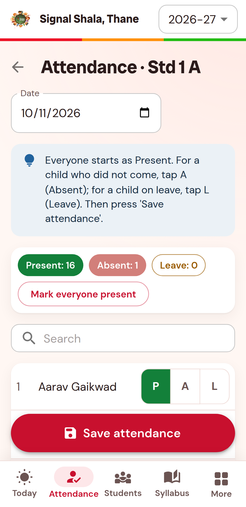
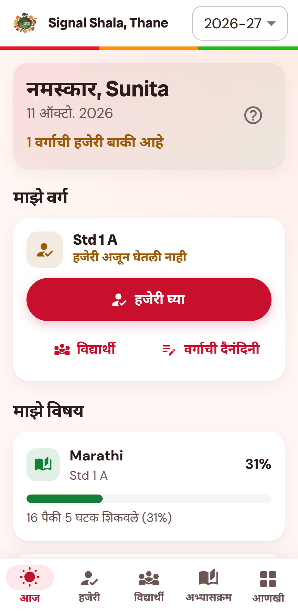
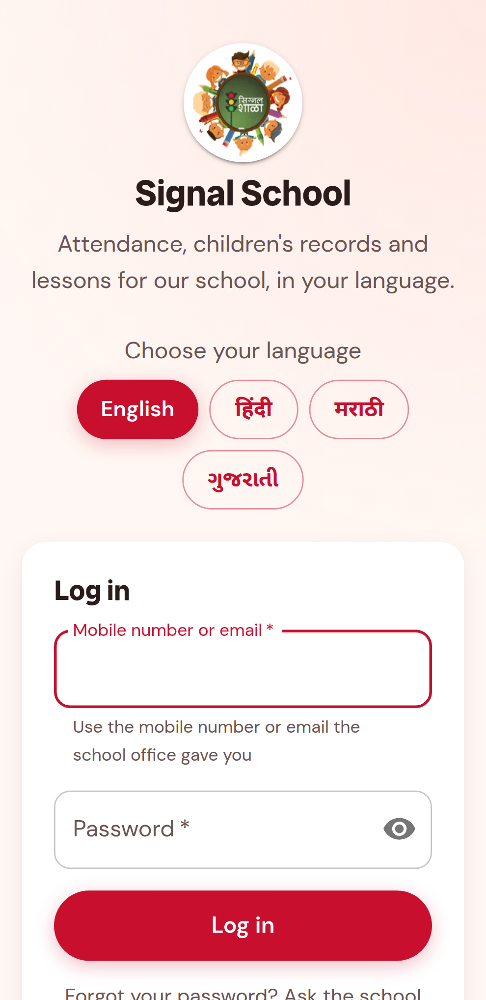
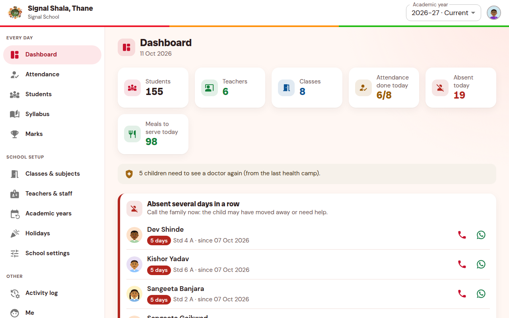
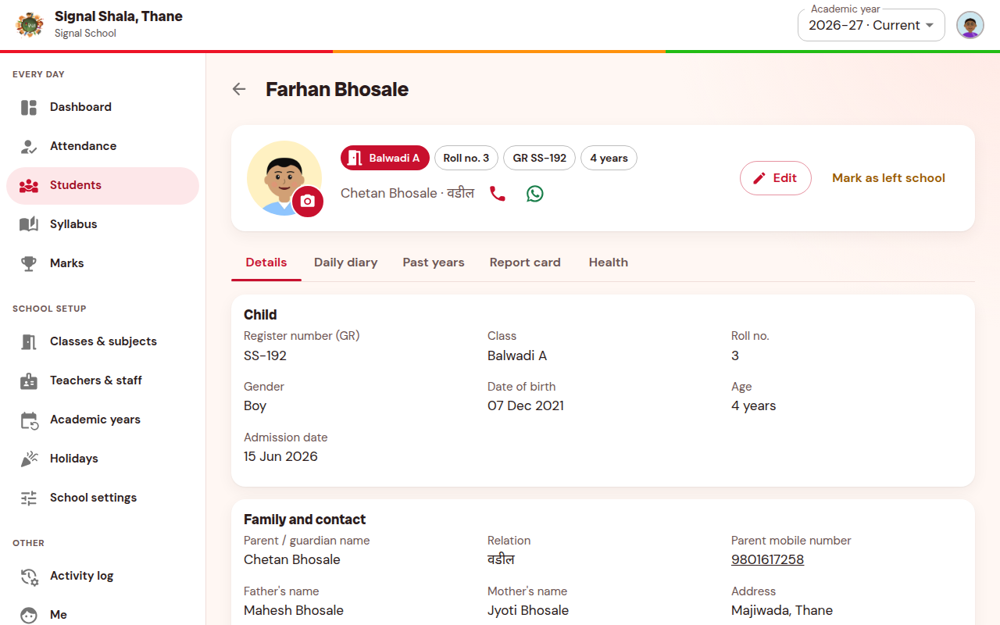
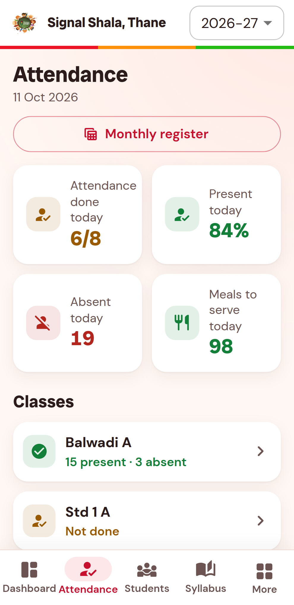
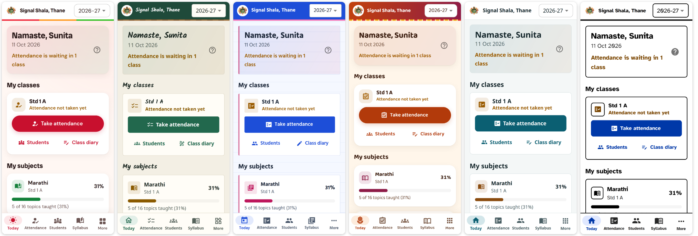

# Signal School — web app (v1)

React 19 + MUI 9 + Vite PWA for teachers and school offices of schools that teach under-privileged children. Works on
cheap phones, takes attendance offline, and speaks English / हिंदी / मराठी / ગુજરાતી. The API is in
**Signal-School-Backend**, which also holds the full documentation (`docs/`: user stories, user guide, architecture,
API, security, testing strategy, deployment).

| Attendance — one tap per child | Teacher home in Marathi | Login with language choice |
|---|---|---|
|  |  |  |

| Principal's dashboard | Child's profile | Today's attendance (phone) |
|---|---|---|
|  |  |  |

### Looks

The principal picks the school's look under **School settings → Look**; everyone in the school then sees it. Each look
has its own colours, fonts, shapes and icons, and all of them pass the same contrast and accessibility checks. There is
no dark look (phones are used outdoors, and printouts must match the screen).



| Look | Feel |
|---|---|
| **Signal Shala** (default) | The school website's red with the traffic-light colours, DM Sans and Radio Canada Big, soft rounded cards, rounded icons |
| **Blackboard** | Green board, chalk-yellow accents, handwritten headings (Kalam), outlined icons |
| **Notebook** | Blue ink on ruled paper with a margin line, Hind, sharp corners and icons |
| **Marigold** | Saffron to maroon, Baloo letters, warm round cards, two-tone icons |
| **Calm teal** | The original quiet teal and white |
| **Easy to read** | Black on white, thick borders, larger Atkinson Hyperlegible letters, yellow focus ring |

More in [`docs/screenshots/`](docs/screenshots) (refresh with `npm run screenshots` against `npm run db:seed -- --school-day`). New here, human or AI agent?
Read [AGENTS.md](AGENTS.md) and [CONTRIBUTING.md](CONTRIBUTING.md).

## Run

```bash
cp .env.example .env      # VITE_API_URL is optional; dev proxies /api and /files to localhost:3000
npm ci
npm run dev               # http://localhost:5173 (start Signal-School-Backend first)
```

Demo logins come from the backend seed (`npm run db:seed`, a two-school Signal Shala with three years of data):
`owner@demo.test`, `principal@demo.test`, `clerk@demo.test`, `sunita@demo.test` (teacher) / `password123`.

## Checks

```bash
npm run lint              # ESLint 9 (flat config) incl. "no untranslated text in JSX"
npm test                  # Vitest: locale parity, look contrast, offline queue, components, utils
npm run build
npx playwright test       # end-to-end at phone (360 px) and desktop width; needs the API running with seed data
npm run screenshots       # refresh docs/screenshots
```

Manual testing by non-technical testers: [`manual-qa/`](manual-qa/README.md) has a PDF guide, the test cases in Excel
and files to upload. Run the API on its QA data (`npm run db:seed:qa`) for it.

## Deploy with Docker

`Dockerfile` builds the app and serves it with nginx (running as an unprivileged user on port 8080), which also
forwards `/api` and `/files` to the API (`API_UPSTREAM`, default `http://api:3000`), gzips, sets security headers and
caches hashed assets for a year. Rebuilds after a code change reuse the dependency layer and npm's download cache. The
whole school (database, Redis, API, this app) starts with `npm run stack` in **Signal-School-Backend**, which clones
this repository; see its `docs/deployment.md`.

```bash
docker build -t signal-school-web .
docker run -p 8080:8080 --add-host=host.docker.internal:host-gateway -e API_UPSTREAM=http://host.docker.internal:3000 signal-school-web
```

## Deploy (Vercel)

`vercel.json` sets the Vite build (`npm run build` → `dist/`), single-page-app routing and security headers. Set
`VITE_API_URL` (e.g. `https://api.example.org`) in the Vercel project's environment variables, and add the deployed web
origin to the API's `CORS_ORIGINS`. Any static host works the same way; see the API repo's `docs/deployment.md` for nginx.

## Structure

```
src/
  api/        client.js (axios, token refresh, error normalisation) · hooks.js (useGet / useSend) · session.js (shared across tabs)
  app/        AuthContext, YearContext, AppLayout (side menu, phone bottom tabs), routes.jsx (lazy, permission-filtered), ErrorBoundary
  theme/      looks.js (the six looks) · build.jsx (MUI theme) · LookContext (useLook, useIcons) · fonts.js · icons/<look>.js (generated)
  i18n/       index.js + locales/{en,hi,mr,gu}.json   ← every visible string lives here
  shared/     components/ (ui, fields, PhotoPicker, SectionSelect, ContactButtons…) · hooks/ · utils/ (format, permissions)
  features/   one folder per area: today, attendance (+ offline queue), students (+ leaving certificate), diary, syllabus,
              marks, health, classes, staff, years (rollover wizard), holidays, school, dashboard, audit, profile, auth
e2e/          Playwright smoke tests and journeys
```

## Conventions

- **Data:** `useGet(url, params)` / `useSend(fn, { invalidate })`. Query keys include school + academic year, so switching either refetches automatically.
- **Academic year:** the header switcher sets `X-Academic-Year`; past years render read-only (`useYear().readOnly`).
- **Permissions:** `can(role, 'perm')` in `shared/utils/permissions.js` mirrors the backend matrix (server stays the authority).
- **Text:** no literal UI strings. Add the key to `en.json` and the other three locales; `npm test` fails if any locale misses a key/placeholder or code uses an unknown key. Plurals use `_one` / `_other`. Use the words teachers use, not technical ones.
- **Layout:** MUI 9 — layout props go in `sx` (`<Stack sx={{ gap: 1 }}>`), Grid uses `size={{ xs: 12, md: 6 }}`, inputs use `slotProps`. Everything must work at 360 px wide with 44 px touch targets; wide tables scroll inside their card.
- **Errors:** the API returns `{ error: { code, fields } }`; codes map to `errors.*` / `fieldErrors.*` translations. Screens are wrapped in an error boundary.
- **Forms with server data:** `useDraft(source)` gives an editable copy that resets when the data refreshes.
- **Offline:** attendance saves to IndexedDB when offline (`features/attendance/offlineQueue.js`) and syncs on reconnect; temporary errors keep the item, refusals are shown to the user; logout clears it.
- **Looks:** icons via `useIcons()` (never imported from `@mui/icons-material` in screens), colours via the palette; see AGENTS.md.
- **Printing:** register (landscape), report card and leaving certificate (`print-portrait`) use browser print, which renders Indic scripts correctly.

## Adding a feature

1. Create `src/features/<area>/<Page>.jsx`.
2. Register it in `app/routes.jsx` (with `perm`) and, if it needs a menu entry, in `NAV` in `app/AppLayout.jsx`.
3. Add strings to all four locale files.
4. Add the route for the relevant roles to `e2e/smoke.spec.js`.
